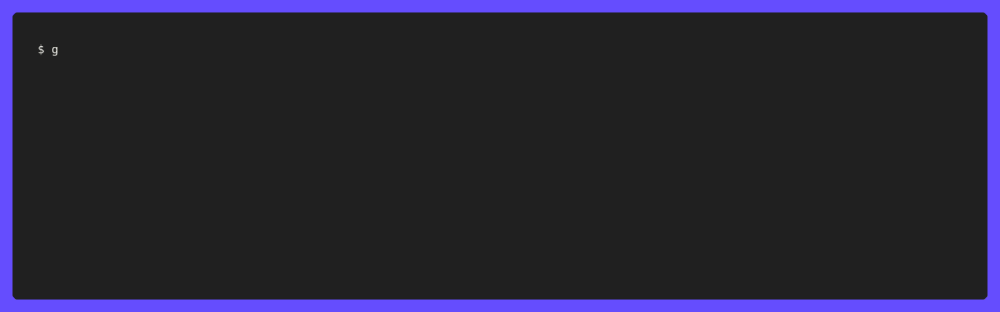

<!-- template:define:options
{
  "nodescription": true
}
-->


<!-- template:begin:header -->
<!-- do not edit anything in this "template" block, its auto-generated -->

<p align="center">
  <a href="https://github.com/lrstanley/bubbletint/releases">
    
  </a>
  <a href="https://github.com/lrstanley/bubbletint/tags">
    
  </a>
  <a href="https://github.com/lrstanley/bubbletint/commits/master">
    
  </a>


  <a href="https://github.com/lrstanley/bubbletint/actions?query=workflow%3Atest+event%3Apush">
    
  </a>


  <a href="https://codecov.io/gh/lrstanley/bubbletint">
    
  </a>

  <a href="https://pkg.go.dev/github.com/lrstanley/bubbletint/v2">
    
  </a>
</p>
<p align="center">
  <a href="https://github.com/lrstanley/bubbletint/issues?q=is:open+is:issue+label:bug">
    
  </a>
  <a href="https://github.com/lrstanley/bubbletint/issues?q=is:open+is:issue+label:enhancement">
    
  </a>
  <a href="https://github.com/lrstanley/bubbletint/pulls">
    
  </a>
  <a href="https://github.com/lrstanley/bubbletint/releases">
    
    
  </a>
  <a href="https://github.com/lrstanley/bubbletint/discussions/new?category=q-a">
    
  </a>
  <a href="https://liam.sh/chat"></a>
</p>
<!-- template:end:header -->

<!-- template:begin:toc -->
<!-- do not edit anything in this "template" block, its auto-generated -->
## :link: Table of Contents

  - [Features](#sparkles-features)
  - [Usage](#gear-usage)
    - [Global registry](#global-registry)
    - [Custom Registry](#custom-registry)
    - [Filter by hue and tone](#filter-by-hue-and-tone)
    - [Use specific tints](#use-specific-tints)
    - [React to changes](#react-to-changes)
    - [Follow the terminal's theme](#follow-the-terminals-theme)
  - [Examples](#clap-examples)
    - [Package manager example](#package-manager-example)
    - [Complex example](#complex-example)
    - [Loading tints from a file](#loading-tints-from-a-file)
    - [Chroma Support](#chroma-support)
    - [Glamour Support](#glamour-support)
    - [Follow the terminal](#follow-the-terminal)
  - [Changes in v2](#rocket-changes-in-v2)
    - [No More Bloated Interfaces](#no-more-bloated-interfaces)
    - [Chroma Support](#chroma-support-1)
    - [JSON Serializable](#json-serializable)
  - [Support &amp; Assistance](#raising_hand_man-support--assistance)
  - [Contributing](#handshake-contributing)
  - [License](#balance_scale-license)
<!-- template:end:toc -->

## :sparkles: Features

- :heavy_check_mark: Utilize 770+ built-in tints. [Check them all out here!](https://lrstanley.github.io/bubbletint/)
  We're taking advantage of the great work others have done
  with [iTerm2-Color-Schemes](https://github.com/mbadolato/iTerm2-Color-Schemes),
  and making them more accessible in a programmatic fashion.
- :heavy_check_mark: Support for dynamically changing tints at runtime, to give
  immediate feedback on which tints might look the best for your application and
  terminal setup.
- :heavy_check_mark: Piecemeal support for specific tints. Really like one specific
  tint, and want to use that as the standard for your TUI? No problem!
- :heavy_check_mark: Filter built-in tints by hue (red, blue, and the rest of the
  spectrum) and tone (muted, retro, and the other aesthetic labels).
- :heavy_check_mark: Extendible with your own custom tints, in addition to marshalling
  and unmarshalling from JSON, if you wanted to support reading/writing tints to
  and from a file.
- :heavy_check_mark: Works with `lipgloss` and similar tools which support the
  `color.Color` interface from **stdlib**!
- :heavy_check_mark: Map a tint onto a [Glamour](https://github.com/charmbracelet/glamour)
  stylesheet through the `glamourtint` sub-package.
- :heavy_check_mark: Get notified when tints are added, replaced, removed, or when the
  current tint changes, with `Subscribe`.
- :heavy_check_mark: Follow the theme of the terminal your app runs in (kitty, Ghostty,
  Alacritty, foot, Windows Terminal, X resources, and iTerm2 color presets), on Linux,
  macOS and Windows, through the opt-in `sources` sub-package.
- :heavy_check_mark: Derive semantic colors (surfaces, muted text, borders, accents,
  status) from any tint, with contrast guards, and fit them to 256, 16 or no colors,
  through the `roles` sub-package.
- :heavy_check_mark: Perceptual color helpers with no dependencies: OKLab mixing, WCAG
  contrast, and contrast guards that keep a color's hue.

---

## :gear: Usage

```console
go get -u github.com/lrstanley/bubbletint/v2@latest
```

[Take a look at all tints here](https://lrstanley.github.io/bubbletint/).

BubbleTint supports three different modes of usage, as shown below:

### Global registry

```go
package main

import (
	// [...]
	tint "github.com/lrstanley/bubbletint/v2"
)


func main() {
	// [...]
	tint.NewDefaultRegistry()
	tint.SetTint(tint.TintDraculaPlus) // Set a specific tint.
	tint.SetTintID("dracula_plus") // Or by ID (this aligns with a Tint's ID field).

	// You can now use the current tint from the registry:
	style := lipgloss.NewStyle().
		SetForeground(tint.Current().Fg).
		Background(tint.Current().BrightGreen)
}
```

### Custom Registry

```go
package main

import (
	// [...]
	tint "github.com/lrstanley/bubbletint/v2"
)


func main() {
	// [...]
	theme := tint.NewRegistry(
		// Default tint.
		tint.TintDraculaPlus,
		// All others you want to register.
		tint.TintCatppuccinFrappe,
		tint.TintCatppuccinMocha,
		tint.TintDraculaPlus,
		tint.TintMonokaiPro,
		tint.TintTinaciousDesignDark,
	}

	theme.Register(tint.TintNord) // Register additional tints on the custom registry.
	theme.SetTint(tint.TintNord) // Can still set a tint on a custom registry.

	// Can also paginate through tints, using PreviousTint/NextTint
	theme.NextTint()

	// You can now use the current tint from the registry:
	style := lipgloss.NewStyle().
		SetForeground(theme.Current().Fg).
		Background(theme.Current().BrightGreen)
}
```

### Filter by hue and tone

Each built-in tint has a hue computed from its ANSI palette, and may have a
tone such as muted or retro. An empty tone means the tint is uncategorized or
has not been classified yet.

```go
package main

import (
	"fmt"

	tint "github.com/lrstanley/bubbletint/v2"
)

func main() {
	// A registry of one hue.
	blues := tint.NewRegistry(nil, tint.TintsByHue(tint.HueBlue)...)

	// Filter that registry by tone.
	for _, theme := range blues.TintsByTone(tint.ToneMuted) {
		fmt.Println(theme.DisplayName)
	}
}
```

### Use specific tints

```go
package main

import (
	// [...]
	tint "github.com/lrstanley/bubbletint/v2"
)

var (
	statusbarStyle = lipgloss.NewStyle().
		SetForeground(tint.TintDraculaPlus.Fg).
		Background(tint.TintDraculaPlus.BrightGreen)
)

// Or:
var (
	theme = tint.TintDraculaPlus
	statusbarStyle = lipgloss.NewStyle().
		SetForeground(theme.Fg).
		Background(theme.BrightGreen)
)
```

### React to changes

`Subscribe` calls your function whenever a registry changes: a tint being added,
replaced or removed, or the current tint changing. `CurrentChanged` is the one to
listen for if all you need to know is when to rebuild your styles. It is also sent
when the current tint is replaced in-place, and when the current tint is removed
and the registry falls back to another tint.

```go
cancel := tint.Subscribe(func(ev tint.Event) {
	if ev.Kind == tint.CurrentChanged {
		p.Send(rebuildStylesMsg{}) // Forward it to your Bubble Tea program.
	}
})
defer cancel()
```

Your function is called synchronously, on the goroutine that made the change, after
the registry's lock is released: it can safely call back into the registry, but it
should return quickly. Subscriptions belong to the registry they were made on, so if
you replace `tint.DefaultRegistry` after subscribing, subscribe again on the new one.

### Follow the terminal's theme

Tints can also come from outside of bubbletint, through a `tint.Source`, which is added
to a registry with `Attach`. Sources are opt-in, and live in their own module, so the
core stays free of dependencies:

```go
import (
	"github.com/lrstanley/bubbletint/sources/v2/terminal"
	tint "github.com/lrstanley/bubbletint/v2"
)

src, err := terminal.Detect() // The source for the terminal we're running in.
if err == nil {
	detach, err := tint.Attach(ctx, src)
	// [...]
}
```

- The source's tints are registered with their ID prefixed by the source's name, e.g.
  `kitty:current`, so they never collide with your own tints.
- By default the registry follows the source: `kitty:current` becomes the current tint,
  and stays up to date as the user changes their terminal's theme (subscribers are told
  about it). Use `tint.WithFollow(false)` to only register the tints.
- Check for `tint.ErrNotFound` (with `errors.Is`) to handle terminals that aren't
  supported, or have no config.

| Package                                   | Reads                                                                 | Platforms                       |
| ----------------------------------------- | --------------------------------------------------------------------- | ------------------------------- |
| `sources/kitty`                           | `kitty.conf` and its includes (e.g. `current-theme.conf`)             | Linux, macOS, BSDs              |
| `sources/ghostty`                         | `config`, its `config-file` includes, and the `theme` it names        | Linux, macOS                    |
| `sources/alacritty`                       | `alacritty.toml` and its `import`s                                    | Linux, macOS, Windows, BSDs     |
| `sources/foot`                            | `foot.ini` and its `include`s                                         | Linux, BSDs                     |
| `sources/windowsterminal`                 | `settings.json` color schemes, and the active profile's scheme        | Windows (and WSL)               |
| `sources/xresources`                      | `~/.Xresources` (xterm, urxvt, st, ...)                               | Linux, BSDs                     |
| `sources/itermcolors`                     | `.itermcolors` files, or a directory of them                          | Anywhere (path must be given)   |
| `sources/terminal`                        | Picks one of the above, from the environment                          | Anywhere                        |

Config files are polled (once a second by default, see `sources.WithPollInterval`)
rather than watched with filesystem notifications, so watching behaves the same on every
platform, and keeps working with editors that replace files and with symlinked dotfiles.
Use `sources.WithPath` to read a config from somewhere other than the default locations.
Writing your own source only takes implementing `Name()` and `Load()` (and `Watch()`,
if it can tell when it changes).

... and that's it!

### Mix colors and check contrast

Beside `Darken` and `Lighten`, colors can be mixed in OKLab, where halfway looks
halfway and hue is kept, and checked or guarded for contrast:

```go
t := tint.Current()

hover := t.Bg.Mix(*t.Fg, 0.12)                // the background, 12% toward the text
ratio := t.BrightBlack.Contrast(*t.Bg)        // WCAG contrast ratio, 1 to 21
hint := t.BrightBlack.EnsureContrast(*t.Bg, 3) // lighter or darker, same hue, until it reads
```

The 16 ANSI colors can also be indexed by `tint.Slot`, with `t.ANSI(tint.SlotBrightRed)`
or `t.ANSI16()`.

### Semantic roles

Most of a TUI isn't drawn in a tint's 16 colors directly, but in colors derived from
them: a dialog a step off the background, secondary text, a soft red behind an error.
The `roles` sub-package works those out, from any tint:

```console
go get -u github.com/lrstanley/bubbletint/roles/v2@latest
```

```go
pal := roles.Derive(tint.Current())
f := pal.Fit(roles.Target{Depth: roles.Colors256}) // from tea.ColorProfileMsg

dialog := lipgloss.NewStyle().Background(f.Color(roles.Raised))
hint := lipgloss.NewStyle().Foreground(f.Color(roles.Subtle))
pill := lipgloss.NewStyle().
	Background(f.Color(roles.Danger)).
	Foreground(f.Color(roles.Danger.On()))

// Text on the selected row, kept readable on the highlight.
row := f.On(roles.Selection)
selectedHint := lipgloss.NewStyle().Foreground(row.Color(roles.Subtle))
```

- Contrast guards keep text, marks and lines readable, moving a color's lightness but
  keeping its hue. They can be turned off with `roles.WithoutGuards()`.
- With 256 colors, no two neighboring roles share an index, and the guards still hold.
- With 16 colors, each role takes a slot from its family that reads on the terminal's
  palette, or the terminal's default plus an attribute (`f.Attr(role)`), such as faint
  for muted text. With no colors, only attributes are left.
- Apps add their own roles with `roles.Define`, derived and fitted like the rest.
- Role names and the API follow semver; the exact colors derived may be tuned in minor
  releases.

## :clap: Examples

### Package manager example

- Uses a static theme with a specific palette for the entire application.
- [Example source](./_examples/package-manager/main.go)



### Complex example

- Uses the default registry (with all tints), and has keybinds to paginate through each tint.
- Note that only a portion of this example is styled (e.g. not a full background color, which
  may make sense for some of the provided tints).
- [Example source](./_examples/complex).


### Loading tints from a file

- Uses the `json` package to load a tint from a file.
- Unmarshalling supports both `RGBA` objects and hex strings.
  - Example: `{"r": 255, "g": 0, "b": 0, "a": 255}` or `"#ff0000"`
  - Hex strings would be easier for end users in most cases.
- Marshalling supports RGBA. This is to ensure that we don't lose the alpha channel
  of the color when marshalling to JSON. Alpha channels default to `255` with all
  of the default tints, but if you use custom tints, this will help keep that info.
- [Example source](./_examples/load-from-file).


### Chroma Support

- Uses the `chromatint` sub-package to render a code example as a `chroma.StyleEntries`,
  using the specified tint.
- [Example source](./_examples/chromatint).


### Glamour Support

- Uses the `glamourtint` sub-package to build a Glamour stylesheet from the current tint.
- Fenced code blocks use the same palette roles as `chromatint`.
- [Example source](./_examples/glamourtint).

```go
import (
	"charm.land/glamour/v2"
	"github.com/lrstanley/bubbletint/glamourtint/v2"
	tint "github.com/lrstanley/bubbletint/v2"
)

renderer, err := glamour.NewTermRenderer(
	glamour.WithStyles(glamourtint.StyleConfig(tint.Current())),
	glamour.WithWordWrap(80),
)
```

---

### Semantic roles example

- Uses the `roles` sub-package to style a small dashboard (surfaces, a selected row, a
  dialog with an input, status pills) from the current tint, and a role of its own.
  Press `d` to see it fitted to 256, 16 and no colors.
- [Example source](./_examples/roles).

### Follow the terminal

- Uses the `sources/terminal` sub-package to follow the theme of the terminal it runs in,
  and `Subscribe` to be told when it changes. Change your terminal's theme while it runs.
- [Example source](./_examples/follow-terminal).

## :rocket: Changes in v2

> [!CAUTION]
> At a high-level, **there are more breaking changes with v2 of bubbletint, than
> not**. You will want to review the new API.

### Remove Reliance on Lipgloss for `color.Color`

Refactored the library as a whole to support the `color.Color` interface directly,
without relying on lipgloss, for more agnostic usage. It should now be possible to
use it with many other libraries without pulling in lipgloss (and other associated
dependencies), though you may still need down-sampling if you're not using
bubbletea/lipgloss, to support non-true-color (or 256bit) terminals.

- This also makes it easier to use with lipgloss v2, as less conversions need to happen now. Example:

  ```go
  theme := tint.TintDraculaPlus
  s := lipgloss.NewStyle().Foreground(theme.Fg)
  ```

- This should make things more performant.
- Should make hex codes more consistent (some themes from our datasources had **4**
  length hex colors, in addition to **7** length, but that should now be normalized as **7** length.
- **Reduces total external dependencies for the main library down to 1**.

### No More Bloated Interfaces

Removed the tint interface with a huge list of both global functions, as well as
methods for querying colors, and have instead opted for a more straightforward
struct for storing color values.

- This has lowered the overall amount of code generated.
- Callers of the library can still implement their own interfaces.
- The global registry still works the same as before, so you don't have to manage
  passing the theme state across many different components.
- Rather than `Registry.Blue()`, you'd do one of:

  ```go
  // Using custom registry. Done during initialization.
  registry := tint.NewRegistry(
      // Default tint.
      tint.TintDraculaPlus,
      // All others you want to register.
      tint.TintCatppuccinFrappe,
      tint.TintCatppuccinMocha,
      tint.TintDraculaPlus,
      tint.TintMonokaiPro,
      tint.TintTinaciousDesignDark,
  )

  // Use it.
  s := lipgloss.NewStyle().
      Foreground(registry.Current().BrightBlue)
  ```

  ```go
  // Using global registry. Done during initialization.
  tint.SetTint(tint.TintDraculaPlus)

  // Use it.
  s := lipgloss.NewStyle().
      Foreground(tint.Current().BrightBlue)
  ```

  ```go
  // Pick a specific tint:
  theme := tint.TintDraculaPlus // Set globally somewhere.

  // Use it.
  s := lipgloss.NewStyle().
      Foreground(theme.BrightBlue)
  ```

### Chroma Support

We now natively support [github.com/alecthomas/chroma](https://github.com/alecthomas/chroma),
through a new sub-package, `github.com/lrstanley/bubbletint/chromatint/v2`. See
[_examples/chromatint](_examples/chromatint). This allows natively mapping bubbletint's
tints to rendered versions of various programming/markup languages.

### JSON Serializable

Tints are now fully JSON serializable.

- When marshalled, they will be stored as RGBA (to not lose the alpha value, if your tints support that).
- When unmarshalled, we support both RGBA (`{"r": 255, "g": 0, "b": 0, "a": 255}`), in addition to hex strings (`"#ff0000"`), which makes it easier for end users to add their own tints.

### `panic()`'s OH MY!

The code now has more resilient fallbacks, reducing the potential chance that developer-error results in a panic.

---

<!-- template:begin:support -->
<!-- do not edit anything in this "template" block, its auto-generated -->
## :raising_hand_man: Support & Assistance

* :heart: Please review the [Code of Conduct](https://github.com/lrstanley/bubbletint?tab=coc-ov-file) for
     guidelines on ensuring everyone has the best experience interacting with
     the community.
* :raising_hand_man: Take a look at the [support](https://github.com/lrstanley/.github/blob/HEAD/.github/SUPPORT.md) document on
     guidelines for tips on how to ask the right questions.
* :lady_beetle: For all features/bugs/issues/questions/etc, [head over here](https://github.com/lrstanley/bubbletint/issues/new/choose).
<!-- template:end:support -->

<!-- template:begin:contributing -->
<!-- do not edit anything in this "template" block, its auto-generated -->
## :handshake: Contributing

* :heart: Please review the [Code of Conduct](https://github.com/lrstanley/bubbletint?tab=coc-ov-file) for guidelines
     on ensuring everyone has the best experience interacting with the
    community.
* :clipboard: Please review the [contributing](https://github.com/lrstanley/bubbletint?tab=contributing-ov-file) doc for submitting
     issues/a guide on submitting pull requests and helping out.
* :old_key: For anything security related, please review this repositories [security policy](https://github.com/lrstanley/bubbletint/security/policy).
<!-- template:end:contributing -->

<!-- template:begin:license -->
<!-- do not edit anything in this "template" block, its auto-generated -->
## :balance_scale: License

```
MIT License

Copyright (c) 2022 Liam Stanley <liam@liam.sh>

Permission is hereby granted, free of charge, to any person obtaining a copy
of this software and associated documentation files (the "Software"), to deal
in the Software without restriction, including without limitation the rights
to use, copy, modify, merge, publish, distribute, sublicense, and/or sell
copies of the Software, and to permit persons to whom the Software is
furnished to do so, subject to the following conditions:

The above copyright notice and this permission notice shall be included in all
copies or substantial portions of the Software.

THE SOFTWARE IS PROVIDED "AS IS", WITHOUT WARRANTY OF ANY KIND, EXPRESS OR
IMPLIED, INCLUDING BUT NOT LIMITED TO THE WARRANTIES OF MERCHANTABILITY,
FITNESS FOR A PARTICULAR PURPOSE AND NONINFRINGEMENT. IN NO EVENT SHALL THE
AUTHORS OR COPYRIGHT HOLDERS BE LIABLE FOR ANY CLAIM, DAMAGES OR OTHER
LIABILITY, WHETHER IN AN ACTION OF CONTRACT, TORT OR OTHERWISE, ARISING FROM,
OUT OF OR IN CONNECTION WITH THE SOFTWARE OR THE USE OR OTHER DEALINGS IN THE
SOFTWARE.
```

_Also located [here](LICENSE)_
<!-- template:end:license -->
